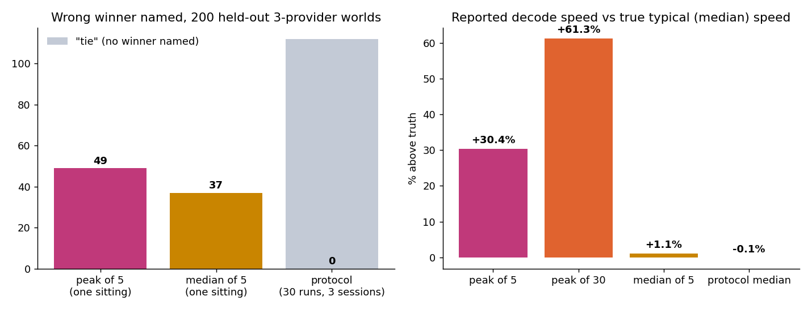

# streambench: a speed benchmark a sceptic can re-run

> Unofficial prototype by Kushagra Pratap Singh. Not affiliated with Piris Labs.

## The problem
[Piris Labs' GLM-5.2 benchmark](https://pirislabs.io/news/glm-benchmark) leads with **"483 tok/s · Peak measured output speed"** and says the team "welcome[s] independent third-party benchmarking". The playground benchmark in the site's public JavaScript runs 5 requests and shows "Peak decode speed", the fastest of the 5. The page doesn't say:
- how many runs were made or what the median and spread were;
- how long the outputs were, what the concurrency was, or what time of day the runs were made;
- how output speed is computed;
- the time to first token (TTFT) at 100k context, where prefill is most of what a user waits for.

That isn't a claim that 483 is wrong; I don't know their protocol. The point is that a buyer who re-measures will compare medians, and the maximum of noisy runs is what a critic attacks first. The maximum climbs as runs are added, and it favours volatile endpoints.

## What I built
A stdlib harness for any OpenAI-compatible streaming endpoint:
- **Client** (`streambench/client.py`): times every SSE event from just before the request is sent. Tokens come from `usage.completion_tokens` (it errors if the endpoint doesn't send usage), never from counting events.
- **Metrics:** TTFT; decode speed (tokens after the first event over the time from first to last event, with the first event's token share estimated from its characters, so coalesced chunks don't skew it); and end-to-end speed (all tokens over the time from send to last token).
- **Protocol:** warm-up, round-robin interleaved order, several sessions at different times of day, fixed output length, and 10k and 100k context.
- **Stats:** median, p10–p90, a bootstrap 95% CI, and a winner only if it beats every other endpoint with confidence. Otherwise it says **tie**. Peak is shown in a column labelled "not a headline".
- **Benchmark card** (`out/card.md`) listing every protocol field needed to re-run it.
- **Simulated endpoints** with known truth: prefill and decode rates, per-request spread, stalls, SSE coalescing and a daily shared-load cycle. The same generator drives the virtual-clock evaluation and a real local HTTP server, and a test checks that HTTP measurements match the virtual clock.

## Results: held-out, first run, no changes after it
The setup:
- **200 worlds** of 3 providers each, with true median decode speeds within about ±20% of each other.
- **Seeds** committed to git ([`heldout/seeds.json`](heldout/seeds.json), commit `24e1357`) before the first run.
- **Outputs** of 512 tokens.
- **Truth** is the median over 600 requests spread across the whole day.



| | Peak of 5, one sitting | Median of 5, one sitting | **Protocol (30 runs, 3 sessions, median + CI)** |
|---|---|---|---|
| Named the wrong fastest provider | 49 / 200 | 37 / 200 | **0 / 200** (said "tie" in 112, right in 88) |
| Reported speed vs true median | **+30.4%** | +1.1% | **−0.1%** |

- **Peak of 30** overstates by **+61.3%**: more runs make the peak worse, not better.
- **Chunked streams:** on the 390 endpoints that send several tokens per event, counting events as tokens is off by **−86.9%**. The harness, using usage, is off by −0.3%.
- **100k context** (simulator assumptions): median TTFT is 4.9 s, and end-to-end speed is 71% below decode speed. In **100 of 200** worlds, the fastest decoder is not the fastest for the user.

**The honest catch: the protocol says "tie" in 112 of 200 worlds.** With providers this close, 30 runs over 3 sessions often can't separate them at 95%. That is the right answer, but it means a "#1" claim needs more runs or a bigger gap.

## Run it
```bash
python demo.py            # 3 simulated endpoints, quick peak test vs protocol (~10 s)
python bench.py --sim     # real HTTP against local simulated endpoints -> out/card.md (~40 s)
python -m pytest -q tests # 6 tests
```
`python evaluate.py heldout` takes ~3 min on 16 cores. For your own endpoints, run `python bench.py --endpoint name=https://host/v1/chat/completions,model-id` with `STREAMBENCH_API_KEY` set.

## Honest limits
- **All results are from simulated endpoints.** The parameter ranges (prefill 8k–40k tok/s, request spread, stalls, load cycle) are my assumptions, not measurements of any provider. I didn't call Piris's API or anyone else's.
- The 100k findings depend mostly on the assumed prefill speed.
- Decode speed uses a character-share estimate for the first event's tokens. It's exact when there's one token per event and within about 0.3% in the evaluation otherwise.
- `bench.py` runs sessions back to back. Spreading them over a day needs a scheduler (cron), with the JSONL merged.
